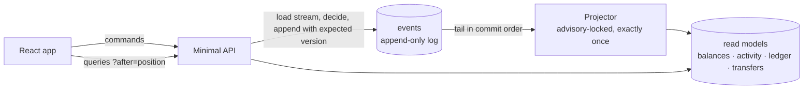

# LedgerPay

[](https://github.com/talhazubairasim/ledgerpay/actions/workflows/ci.yml)

An **event-sourced digital wallet**: customers open wallets, add and withdraw money and send it
to each other. Every change is an immutable event; balances, statements and the ledger are
projections of that log. Transfers are atomic, safe to retry, screened by fraud rules, and
booked as **double-entry** postings that must always balance.

**.NET 8 · PostgreSQL (hand-written event store, no ORM) · CQRS · React + TypeScript · Docker · Kubernetes**

## Architecture



**Write side.** A wallet (`Account`) and a `Transfer` are aggregates rebuilt by replaying their
streams. A command loads the stream, checks the business rules (funds, frozen, daily limit) and
appends new events *with the version it read*. If someone else appended first, the unique
`(stream, version)` constraint rejects the write and the command reloads and retries.

**Transfers are one transaction across three streams.** The debit (`TransferSent`), the credit
(`TransferReceived`) and `TransferCompleted` are appended together, each checking its expected
version, so money is never half-moved. A test fires five 30.00 transfers at a 100.00 wallet
concurrently: exactly three complete and two are rejected for insufficient funds.

**Idempotency without a side table.** The transfer id is derived from (user, `Idempotency-Key`),
so a retried request lands on the same stream and returns the original result instead of
paying twice. Reusing a key for a different amount is refused.

**Fraud screening.** Rules score each transfer: large amounts, five or more transfers in ten
minutes, a first large payment to a new payee, draining most of a wallet. A score of 50 or more
holds the transfer for a back-office reviewer (no self-approval); approval executes it, and
rejection leaves the money where it was.

**Read side.** A projector tails the log and updates the read models and its checkpoint in one
transaction (exactly-once). It reads in `(transaction id, position)` order and only past the
oldest in-flight transaction (`pg_snapshot_xmin`), so an event that commits late with a lower
`bigserial` position is never skipped. A Postgres advisory lock keeps it to one projector
across replicas. Commands return their log position, and queries take `?after=` to wait for
it: read-your-writes on an eventually consistent model. The read models are disposable:
**Rebuild projections** truncates them and replays the log.

**Double-entry ledger.** Every money event posts balanced lines:

| Event | Posting |
|---|---|
| Deposit | `wallet:{id}` +x, `external:{CUR}` −x |
| Withdrawal | `wallet:{id}` −x, `external:{CUR}` +x |
| Transfer | `wallet:{from}` −x, `clearing:{CUR}` +x, then `clearing:{CUR}` −x, `wallet:{to}` +x |

`GET /api/admin/trial-balance` proves each currency sums to zero, clearing is empty, and every
wallet's ledger total equals its balance. A domain test replays 2,000 random operations and
checks the same invariants.

## Run it

```bash
docker compose up --build
```

| | |
|---|---|
| App | http://localhost:3000 |
| Customer | `demo@ledgerpay.dev` / `Demo#2025` (three seeded wallets) |
| Back office | `admin@ledgerpay.dev` / `Admin#2025` (review queue, trial balance, event log, rebuild) |
| API + Swagger | http://localhost:5300/swagger |

`./scripts/e2e.sh` drives the running stack end to end: deposits, an idempotent transfer, a
flagged transfer approved by a reviewer, a balanced trial balance, and a projection rebuild
that reproduces the same balances.

## Tests

```bash
dotnet test                         # domain + API tests on real Postgres (Testcontainers; needs Docker)
cd web && npm install && npm test   # React app (Vitest + Testing Library)
```

CI runs both, then starts the stack with Docker Compose and runs the end-to-end script.

## Layout

```
src/LedgerPay.Domain   Events, Account and Transfer aggregates, fraud rules, ledger postings (no dependencies)
src/LedgerPay.Api      EventStore (Npgsql + SQL), Projector and read models, commands, queries, JWT auth
tests/                 Domain tests (incl. randomized ledger invariants); API tests with Testcontainers
web/                   React 18 + Vite + Tailwind app
deploy/k8s             Postgres StatefulSet, API and web Deployments, Ingress
```
